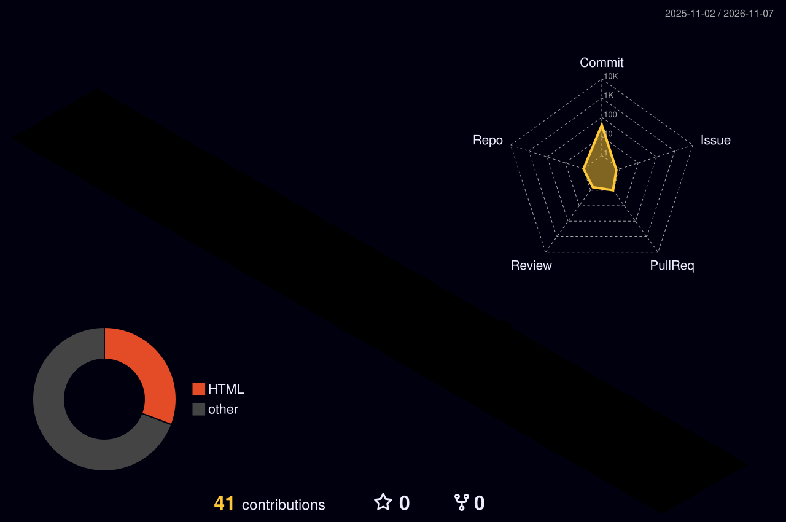

<div align="center">

### `> Nguyen Hoai Thuong` — AI Team Lead · AI Fullstack Developer

[](https://git.io/typing-svg)

[](https://hoaithuong81.id.vn/)
[](mailto:thuonggg81@gmail.com)
[](https://github.com/thuongnguyen81)

</div>


## `whoami`

```python
class Zaden:
    name      = "Nguyen Hoai Thuong"
    alias     = "zaden"
    role      = "AI Team Lead @ DFC Flow"
    focus     = ["LLM Agents", "Chatbots", "Computer Vision", "Web Applications"]
    stack     = {
        "LLM"     : ["Claude", "OpenAI", "Gemini", "LangGraph", "MCP", "RAG"],
        "AI/ML"   : ["PyTorch", "Keras", "YOLO", "OpenCV"],
        "Backend" : ["Python", "FastAPI", "Flask", "Node.js"],
        "Frontend": ["Next.js", "React", "TypeScript"],
        "Data"    : ["PostgreSQL", "Qdrant", "Redis"],
        "Ship"    : ["Docker", "Fly.io", "GitHub Actions", "Playwright"],
    }
    currently = "Leading a team that turns AI models into real products 🚀"
```

---

## `tech stack`

<div align="center">

**LLM & Agents**


**AI / Machine Learning**


**Frontend**


**Backend / Data**


**Ship & Test**


</div>

---

## `experience`

**DFC Flow** · *Nov 2025 — Present*

*AMOIQ — an AI platform where chatbots and agents work with a business's commerce, CRM and ERP data.*

**AI Team Lead** · *Mar 2026 — Present*

- Lead the AI team and own cross-area work across AI backend, frontend, gateway and MCP — planning, code review, releases to production
- Own the AMOIQ agent system end to end — architecture, prompts and tooling for one router over 30+ specialist agents and 300+ tools, with human-in-the-loop approvals
- Extended the MCP tool layer to 15+ business modules (orders, CRM, finance, inbox, marketing…) so AI agents act on real data
- Trace production failures across gateway, AI backend and database down to the root cause — e.g. chat hangs from dead database connections
- Built automated quality gates — Playwright end-to-end chat tests, a daily stability run, AI review on every PR into main across 8 repos

**AI Engineer** · *Nov 2025 — Mar 2026*

- Co-designed the multi-agent chatbot — intent routing, response formatting, agent coordination
- Built the admin dashboard (Next.js, TypeScript) and the API contracts with the AI backend
- Tuned the RAG pipeline for better retrieval on domain-specific knowledge


**Savepet** · AI Developer Intern · *Apr 2025 — Aug 2025*

- Built an AI system for dog and cat recognition with YOLOv11 — data collection, preprocessing, training
- Classified pet fur colors with a fine-tuned MobileNetV2 — 87% accuracy (target ≥ 80%)
- Deployed the solution as a Flask web application


---

## `3d contribution`

<div align="center">

<picture>
  <source media="(prefers-color-scheme: dark)" srcset="./profile-3d-contrib/profile-night-rainbow.svg" />
  <source media="(prefers-color-scheme: light)" srcset="./profile-3d-contrib/profile-season.svg" />
  
</picture>

<sub>Day-to-day work happens in private repos on <a href="https://github.com/thuongnguyen81">@thuongnguyen81</a>.</sub>

</div>

---

<div align="center">


*`> "From zero to deployed — AI that actually works."`*

</div>
